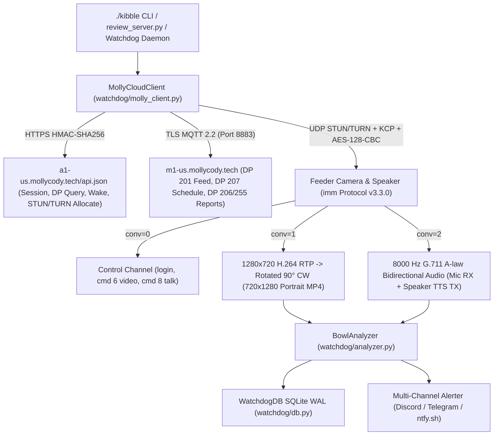

# 🐶 MollyCodyFeeder (`v0.7.0`) — Standalone Native Home Assistant HACS Integration & Anti-Clog Classifier

**MollyCodyFeeder** (`custom_components/molly_cody_feeder/`, domain `molly_cody_feeder`) is a **100% standalone, native Home Assistant HACS custom integration** for the **Molly & Cody 6L Smart Pet Feeder with Camera** (`and.mollycody.app01` / Tuya OEM `yv8xga2javjxtqdc`).

> **100% Standalone Native HACS Architecture (Zero External VPS Required):** The `v0.7.0` Home Assistant HACS integration runs completely inside Home Assistant (`custom_components/molly_cody_feeder/core/`) with **zero external VPS or external watchdog server dependency**. It features an **Ultra-Lightweight Audio-Only Anti-Clog Verification Mode** engineered specifically for small-compute HAOS boxes (Raspberry Pi, Home Assistant Green, Home Assistant Yellow), alongside individually toggleable Camera snapshots (`imm` `AES/KCP 330`), two-way speaker TTS (`G.711 mulaw`), and optional Visual Inner-Bowl Verification (`BowlAnalyzer`).

---

## 🏠 Home Assistant HACS Installation & Configuration (`v0.7.0`)

### 1. Install via HACS
1. In Home Assistant, navigate to **HACS → Integrations → ⋮ (top right menu) → Custom repositories**.
2. Add this repository URL with category **Integration**, then click **Download** on **Molly & Cody Smart Feeder**.
3. Restart Home Assistant.
4. Go to **Settings → Devices & Services → Add Integration** and select **Molly & Cody Smart Feeder** (`molly_cody_feeder`).
5. Configure your connection mode (`auto`, `cloud`, or `lan`), Molly & Cody Cloud credentials (and/or local LAN IP + 16-byte Local Key), and modular compute toggles.

### 2. Ultra-Lightweight Audio-Only Anti-Clog Verification Mode for Small-Compute HAOS Boxes (Raspberry Pi / HA Green / Yellow)
Confirming whether kibble actually hit the stainless-steel bowl does **not** require video decoding: the acoustic signature of the **auger motor spinning alone** (clogged chute or empty hopper) vs. **motor + hard kibble pellets striking the steel bowl** is unmistakable.

- **Tiny Bandwidth (`~8 KB/s`)**: On the feeder's `imm` (`AES/KCP 330`) protocol, microphone audio (`conv=2`) is **8000 Hz mono G.711 A-law** (`~8 KB/s` — only `~100–240 KB` for an entire meal!).
- **Zero-Video, Zero-FFmpeg Capture (`capture_audio_clip` / `audio_only=True`)**:
  - In Audio-Only Verification mode (`enable_verification=True`, `enable_vision_verification=False`, `enable_camera=False`), the integration opens only `conv=0` (control) + `conv=2` (`cmd 0x00040006` start audio) and **completely skips starting the `conv=1` 1280×720 H.264 video stream (`cmd 6`)**.
  - G.711 A-law packets are decoded directly in Python via a **256-entry lookup table** and written to `.wav` using Python's stdlib `wave` module — requiring **zero `ffmpeg` subprocesses, zero H.264 video decoding, and no `opencv` or `Pillow`**.
- **Milliseconds of CPU & `< 2 MB` RAM (NumPy + Pure-Python Stdlib Fallback)**:
  - `core/analysis/audio.py`, `core/analysis/ting.py`, and `core/analysis/flow.py` run allocation-frugal 1D signal processing (supporting both NumPy and a pure-Python stdlib `math`/`struct` fallback when NumPy is not loaded) to classify every feed in milliseconds:
    - **Motor Only (`motor_no_kibble` / Clog or Empty Hopper)**: sustained `200–900 Hz` auger motor hum (`motor_detected=True`) with near-zero kibble impact spikes/tings (`kibble_dispensed_audio=False`).
    - **Motor + Food Dispensed (`verified` / `dispensed` / Fed)**: sustained `200–900 Hz` motor hum + clear kibble impact clatter (`>= 15` spikes in `1500–3800 Hz`) and 256-pt STFT metallic bowl tings (`ting_rate_per_sec >= 4.6` normal, `< 4.6` `weak_flow`).
    - **No Motor (`no_motor`)**: feeder never ran (`motor_detected=False`).
- **Recommended Small-Compute HAOS Profile**:
  - `enable_verification=True`, `enable_vision_verification=False`, `enable_camera=False` (lightweight default/recommended verification mode for HAOS boxes).

### 3. Modular Compute Feature Toggles (Config Flow & Options Flow)
Not every Home Assistant host has the same CPU budget. Every compute-intensive capability can be toggled at setup or anytime at runtime via **Configure (Options Flow)** or config switches:

| Option Key | Lightweight HAOS Profile | Description |
| :--- | :---: | :--- |
| `enable_verification` | `true` | Enables ultra-lightweight Audio-Only anti-clog verification (`conv=2` 8 kHz mono G.711 A-law, 10ms RMS `200–900 Hz` motor window + `1500–3800 Hz` kibble clatter `>= 15` spikes + 256-pt STFT spectral-flux `ting` detector `ting_rate_per_sec >= 4.6` + learned per-feeder baselines in `< 2 MB` RAM). |
| `enable_vision_verification` | `false` | Optional OpenCV/Pillow `BowlAnalyzer` inner-bowl fill analysis (`DAY_PIT` daylight & `IR_BAND` infrared night-vision modes, dog-at-bowl guard, and before/after/annotated `ImageEntity` updates). When `false`, `audio_only=True` / `decode_video=False` skips `cmd 6` H.264 video streaming and decoding. |
| `enable_camera` | `false` | Optional live `720×1280` portrait camera snapshots via Cloud `imm` (`AES/KCP 330`). When `false`, the camera entity never initiates live KCP sessions and returns cached/None bytes with zero compute overhead. |
| `enable_tts` | `true` | Enables two-way speaker talkback (`play_tts`, `play_audio`, `play_chime`) over KCP `conv=2` (`8000 Hz` mono G.711 μ-law, `codec=0x86`, `reqId=7`). |
| `enable_mp4_recording` | `false` | Enables full-feed H.264 MP4 + AAC clip muxing and automated `RetentionManager` pruning. |
| `enable_auto_retry` | `true` | Enables a 1-portion anti-jam auto-retry on `motor_no_kibble`/`no_motor`, bounded by `max_daily_retry_portions` and `hopper_empty_suspected` stop when two consecutive motor runs produce zero kibble. |

### 4. Entity Platforms (9 Platforms, 77 Entities)
- **`sensor` (22 entities)**: `status`, `active_transport`, `configured_mode`, `last_meal_time`, `last_meal_result`, `last_meal_portions`, `minutes_since_last_meal`, `next_meal_time`, `minutes_to_next_meal`, `today_meals`, `today_fed`, `today_problems`, `today_portions`, `week_confirmed_pct`, `kibble_flow`, `kibble_flow_7d_avg`, `last_motor_duration_sec`, `hopper_percent`, `hopper_portions_left`, `hopper_days_left`, `bowl_fill_pct`, `schedule`.
- **`binary_sensor` (9 entities)**: `online`, `clog_detected`, `hardware_fault` (True only when `DP 255 > 1`; `== 1` is normal), `hopper_low`, `food_present`, `dog_at_bowl`, `is_infrared_mode`, `busy`, `weak_flow_warning`.
- **`switch` (16 entities)**: Schedule Slot `1..8` enable switches (`slot_1_enabled`..`slot_8_enabled`), Hardware DP switches (`indicator_light` DP 101, `flip_screen` DP 103, `osd_watermark` DP 104, `motion_switch` DP 134), and runtime compute toggles (`enable_auto_retry`, `enable_tts`, `enable_verification`, `enable_vision_verification`).
- **`button` (8 entities)**: `feed_1_portion`, `verify_feed`, `check_bowl`, `capture_snapshot`, `refill_hopper`, `play_chime`, `sync_schedules`, `clear_clog_alert`.
- **`number` (12 entities)**: `feed_portions` (`1..20`), `hopper_capacity_portions` (`10..500`), `portion_weight_g` (`1..50`), `tts_volume` (`0.1..5.0`), and Schedule Slot `1..8` portion numbers (`slot_1_portions`..`slot_8_portions`, `1..20`).
- **`select` (4 entities)**: `connection_mode` (`auto`, `cloud`, `lan`), `nightvision` (DP 108: `auto`, `off`, `on`), `motion_sensitivity` (DP 106: `low`, `medium`, `high`), `alert_mode` (`every_miss`, `no_food_hours`).
- **`camera` (1 entity)**: `MollyCodyBowlCamera` (`bowl_camera`, upright `720×1280` JPEG snapshot, respects `enable_camera` and shared `imm` session lock).
- **`image` (3 entities)**: `annotated_bowl`, `before_feed`, `after_feed`.
- **`event` (2 entities)**: `feed_event` (`molly_cody_feeder_feed_event`) and `alert_event` (`molly_cody_feeder_alert_event`).

### 5. Custom Home Assistant Services (14 Services)
All services are registered under domain `molly_cody_feeder`:
`feed`, `verify_feed`, `check_bowl`, `set_schedule_slot`, `set_schedule_raw`, `sync_schedules`, `refill_hopper`, `capture_snapshot`, `play_tts`, `play_audio`, `play_chime`, `set_dp`, `run_online_check`, `clear_clog_alert`.

### 6. Lovelace Dashboard & Automation Blueprints
- **Lovelace Dashboard**: Import [`lovelace/molly_cody_dashboard.yaml`](lovelace/molly_cody_dashboard.yaml) for a 2-tab dashboard covering live bowl camera & before/after/annotated verification images, anti-clog telemetry, hopper gauge, quick action buttons, DP 207 schedule slots 1–8, and hardware/compute switches.
- **Automation Blueprints**:
  - [`blueprints/automation/molly_cody_feeder/clog_alert_notification.yaml`](blueprints/automation/molly_cody_feeder/clog_alert_notification.yaml) — Clog, missed meal & hardware fault notification + optional feeder speaker TTS alert.
  - [`blueprints/automation/molly_cody_feeder/hopper_low_reminder.yaml`](blueprints/automation/molly_cody_feeder/hopper_low_reminder.yaml) — Low-hopper refill reminder notification.

---

## ✨ Key Capabilities

1. **100% Cloud-Native Control & Live Streaming (Zero LAN Dependency)**
   - Works from any remote Linux VPS or local machine without needing to share a Wi-Fi network with the feeder.
   - Reverse-engineered **Molly & Cody OEM Tuya Cloud API** (`https://a1-us.mollycody.tech/api.json`) with full HMAC-SHA256 request signing.
   - Reverse-engineered **Tuya MQTT 2.2** (`m1-us.mollycody.tech:8883`) for instant real-time Data Point (`DP`) command publishing and telemetry (`protocol=4` / `protocol=5`, `pv=2.2`).
   - Reverse-engineered **100% Cloud `imm` (`AES/KCP 330`) P2P/TURN Relay Protocol** (`conv=0` JSON control channel, `conv=1` 1280×720@15fps H.264 video auto-rotated 90° CW to `720×1280` portrait, `conv=2` bidirectional 8000 Hz G.711 A-law audio).
2. **Two-Source-of-Truth Anti-Clog Verification (Audio + Visual)**
   - **Source 1 — Acoustic Clatter vs. Motor Churn Detection**: Isolates the contiguous auger motor churning window (`200–900 Hz` motor hum vs. `1.5–3.8 kHz` kibble-on-stainless-steel impact transients). Distinguishes normal dispensing (`35–40+` sharp impact spikes per portion) from an **empty hopper or clogged chute** where the motor churns for ~2.5s (`motor_detected=True`) with near-zero kibble impact spikes (`< 15`).
   - **Source 2 — Inner-Bowl Visual Fill Analysis**: Crops the inner stainless steel dish pit (`x: 0.32..0.75, y: 0.88..0.985`), normalizes against the empty-bowl dark shadow baseline (`0.130`), and tracks dark brown kibble fill increases while filtering out false positives when a pet's head enters the frame (`dog_at_bowl_detected`).
3. **Two-Way Audio (Microphone Recording + Speaker TTS / Custom Audio)**
   - Captures live 8000 Hz G.711 A-law microphone audio multiplexed into every MP4 verification clip and saved as standalone `.wav` files.
   - Streams clean **Text-to-Speech (`./kibble say "..."`)** or custom audio files (`./kibble play-audio ...`) directly out of the feeder's built-in speaker over KCP `conv=2` with full packet retransmission and hardware amplifier unmute timing.
4. **Full Schedule Management (`DP 207`)**
   - Decodes and encodes the proprietary 15-character base64-like `DP 207` schedule string, supporting listing, adding, editing, enabling/disabling, and deleting scheduled meals (`1–20` portions per meal).
5. **Interactive Review & Ground-Truth Training Lab (`review_server.py`)**
   - Local mobile-friendly web UI for triggering test feeds (`1–20` servings), testing Speaker TTS live, watching captured audio+video clips, and labeling ground-truth outcomes (`food_came_out`, `heard_motor`, `heard_kibble_clatter`, `saw_food_in_bowl`, `dog_ate_immediately`) stored in `captures/review_clips/training_labels.json`.
6. **Crash-Safe SQLite WAL Persistence & Self-Healing Outbound-Only Docker Deployment**
   - Stores every feed event, acoustic/visual metric, schedule snapshot, and alert in SQLite with `journal_mode=WAL`, `synchronous=FULL`, automatic integrity checks, and online backups (`watchdog/db.py`).
   - Runs as an **outbound-only** Docker container (`docker-compose.yml`) with zero exposed inbound ports on your VPS.

---

## 🏗️ Architecture Overview



---

## 🔬 Reverse-Engineered Protocol Reference

### 1. Molly & Cody OEM Tuya Cloud API
Extracted from the official Android APK (`and.mollycody.app01` v1.2.9):
- **API Endpoint (US)**: `https://a1-us.mollycody.tech/api.json`
- **MQTT Broker (US)**: `m1-us.mollycody.tech:8883` (TLS)
- **OEM App Key (`clientId`)**: `c9c73ux39ac379g7x3xr`
- **APK Cert SHA256**: `0D:9A:FF:88:84:DF:BF:CD:9A:24:5B:FC:D8:24:EC:34:41:56:6B:AD:9C:1B:6C:91:DD:6C:BC:7B:EB:B0:E3:EC`
- **HMAC Key Format**: `<BMP_SECRET>_c9c73ux39ac379g7x3xr_<CERT_SHA256>`

### 2. Feeder Tuya Data Points (DPs)
| DP ID | Name | Type | Description |
| :--- | :--- | :--- | :--- |
| **`201`** | `manual_feed` | Integer (`1–20`) | Dispenses `N` portions immediately (`{"201": 1}`). |
| **`202`** | `weight_cali` / `bowl_weight` | Integer | Bowl weight telemetry (`0` when unweighted/empty). |
| **`206`** | `feed_report` | Raw / String | Last feed execution status report from the MCU. |
| **`207`** | `meal_plan` | String (`15 chars/entry`) | Concatenated 15-character blocks defining each scheduled meal. |
| **`255`** | `fault` / `abnormal` | Bitmap / Int | Hardware fault flag (`0` = normal, non-zero = jam/motor/sensor fault). |

#### `DP 207` 15-Character Schedule Encoding
`DP 207` is a concatenation of 15-character ASCII slots (`watchdog/schedule_decoder.py`):

| Chars | Field | Encoding | Example |
| :--- | :--- | :--- | :--- |
| `0..1` | Days bitmask | 2-char **hex** (bit0=Mon … bit6=Sun; `7f` = every day, `00` = once) | `7f` |
| `2..3` | Hour | 2-char decimal | `07` |
| `4..5` | Minute | 2-char decimal | `00` |
| `6..7` | Portions | 2-char decimal (`01`–`20`) | `20` |
| `8` | Enabled | `1` = on, `0` = off | `1` |
| `9..14` | Reserved | `000000` | `000000` |

Live example (5 slots): `7f0700201000000 7f1100201000000 7f1600201000000 7f1900171000000 000908100000000`
→ 07:00 / 11:00 / 16:00 every day ×20 portions, 19:00 ×17, plus a disabled one-off at 09:08.

### 3. Cloud `imm` (`AES/KCP 330`) Camera & Two-Way Audio Protocol
Implemented in `watchdog/molly_client.py` (`_imm_session_async`, `_ImmSessionProtocol`, `_imm_talk`):

1. **Signaling** — `m.ipc.v4.rtc.config.get` returns the device password, `auth`, `motoId` and STUN/TURN servers.
   An SDP offer with `m=application 9 imm 6001` / `a=rtpmap:6001 AES/KCP 330` is published over MQTT
   (`protocol=302`) to `/av/moto/<motoId>/u/<devId>`; the answer (ICE ufrag/pwd, `a=aes-key`) and candidates
   arrive on `/av/u/<uid>`. ICE connectivity uses STUN binding requests to the camera's relay/srflx candidates.
2. **Transport** — after ICE, each UDP datagram is one or more raw KCP segments
   (`conv, cmd, frg, wnd, ts, sn, una, len` little-endian) followed by a 20-byte HMAC-SHA1 tag keyed with the
   session AES key. Each reassembled KCP message is **AES-128-CBC** (random 16-byte IV prefix, PKCS#7).
3. **Control channel (`conv=0`)** — binary messages: `magic 0x12345678 | reqId | flags | cmd | len | payload`
   (replies set `flags=1`). Login message = `magic | 1 | "admin"[32] | md5(password||localKey)[32]`, then:
   `cmd 10` capability exchange, `cmd 2` audio params (reply: codec `0x86` G.711A, 8 kHz, 16-bit, mono),
   `cmd 9` resolution (HD), `cmd 6` start video, `cmd 0x00040006` start audio, `cmd 8` talk open/close.
4. **Media**
   - **`conv=1` video RX** — H.264 RTP (FU-A) 1280×720@15 fps, rotated 90° CW to 720×1280 portrait.
   - **`conv=2` mic RX** — `0x00010005` media header + RTP PT 8 (G.711 A-law, 8 kHz, 40 ms packets).
   - **`conv=2` speaker TX** (verified on-device in v0.1 via mic loopback) — after `cmd 8` (reqId `7`), send
     `magic 0x12345678 | reqId | codec 0x86 | rate 0 | bits 1 | mono 0 | ts_ms | len` + 320 bytes (40 ms) A-law,
     real-time paced. **The header reqId must equal the talk-open reqId**: with `0` the camera ACKs the KCP
     segments but silently discards the audio (that was the "TTS doesn't work" bug).

---

## 🎯 Two-Source-of-Truth Anti-Clog Classifier (`watchdog/analyzer.py`)

A pet feeder failure happens in one of two ways:
1. **Hardware Jam (`DP 255 != 0`)**: The motor stalls and the MCU reports an abnormal flag.
2. **Silent Starvation (Empty Hopper or Clogged Chute)**: The motor spins normally for ~2.6 seconds (`DP 206` reports "success" and `DP 255 == 0`), **but zero kibble actually drops into the bowl**.

`BowlAnalyzer` solves this by combining **Acoustic Impact Analysis** and **Visual Inner-Bowl Fill Analysis**:

### Source 1: Acoustic Motor-Window vs. Kibble Impact Clatter
- Computes 10ms frame-by-frame RMS and peak envelopes in two frequency bands:
  - **Motor Band (`200–900 Hz`)**: Detects the continuous auger motor hum (`motor_duration_sec`, typically `2.4s–2.9s` for 1 portion).
  - **Kibble Clatter Band (`1500–3800 Hz`)**: Counts sharp 10ms transient spikes (`rms > 0.165` and `peak > 0.40`) inside the motor window caused by hard kibble pellets striking the stainless steel bowl.
- **Decision Rule**:
  - Normal 1-portion dispense: `~35–40` sharp kibble impact spikes during the motor window (`kibble_dispensed_audio = True`).
  - Clogged chute / empty hopper: Motor runs (`motor_detected = True`, `~2.5s`), but produces `< 15` transient spikes (`kibble_dispensed_audio = False` -> **CLOG DETECTED**).

### Source 2: Visual Inner-Bowl Fill Ratio
- Crops the inner stainless steel bowl pit (`x: 0.32..0.75, y: 0.88..0.985` of the `720×1280` portrait frame).
- Subtracts the empty-bowl dark shadow baseline (`0.130`) so an empty bowl reads `~0.0%–1.5%` fill.
- Compares `before_fill` (first seconds of clip before kibble drops) against `after_fill` (last seconds of clip after dispense settles).
- Detects if the dog steps into the frame (`dog_at_bowl_detected`) so a dog's head or eating motion is flagged without falsely marking an empty dispense as `food_increased = True`.

### Ground-Truth Calibration Results (`captures/review_clips/training_labels.json`)
| Clip ID | Ground Truth Scenario | Motor Detected | Acoustic Impact Spikes | Audio Verdict | Visual Fill (`Before -> After`) | Final Classifier Verdict |
| :--- | :--- | :---: | :---: | :---: | :---: | :---: |
| `20261029_174950_feed_1p` | **1 portion into empty bowl** | ✅ `2.69s` | **`39`** (`>= 15`) | ✅ Dispensed | `0.3% -> 14.5%` (`+14.2%`) | ✅ **VERIFIED DISPENSED** |
| `20261029_175236_feed_1p` | **1 portion into bowl with food** | ✅ `2.78s` | **`38`** (`>= 15`) | ✅ Dispensed | `15.7% -> 21.6%` (`+5.9%`) | ✅ **VERIFIED DISPENSED** |
| `20261029_175345_feed_1p` | **1 portion with clogged chute (no food came out)** | ✅ `2.54s` | **`9`** (`< 15`) | 🚨 **CLOGGED** | `23.5% -> 20.5%` (`-3.0%`) | 🚨 **CLOG / EMPTY HOPPER** |

---

## 🛠️ CLI Usage (`./kibble`)

The `./kibble` CLI (`feeder_cli.py`) provides full command-line control over the feeder:

```bash
# 1. Check feeder online status, fault code, schedule, and recent DB events
./kibble status

# 2. Dispense 1 portion AND verify via live Cloud Camera + Mic (Audio + Vision)
./kibble feed --portions 1

# 3. Dispense without camera recording (instant MQTT command)
./kibble feed --portions 2 --no-verify

# 4. Run a standalone camera + audio verification check (no feed triggered)
./kibble verify --duration 12

# 5. Speak a message through the feeder's speaker (Cloud TTS)
./kibble say "Dinner time! Come get your food!"

# 6. Play any local WAV/MP3 audio file through the feeder's speaker
./kibble play-audio ./my_sound.wav

# 7. Capture a live portrait snapshot or MP4 video+audio clip
./kibble camera --snapshot captures/latest.jpg
./kibble camera --clip captures/clip.mp4 --duration 10

# 8. View and manage the feeder's internal meal schedule (DP 207)
./kibble schedule list
./kibble schedule add --time 07:30 --portions 2 --days everyday
./kibble schedule toggle --index 1 --enable
./kibble schedule delete --index 1

# 9. Hopper estimate (mark a refill right after filling the hopper)
./kibble refill --capacity 240
./kibble hopper

# 10. Inspect crash-safe SQLite database history & backups
./kibble history --limit 20
./kibble db-backup
```

---

## 🛡️ Pet-Safety Features (v0.1–v0.2)

| Problem | What the watchdog does |
| :--- | :--- |
| Chute clogged / hopper empty (motor spins, no kibble) | `motor_no_kibble` outcome → urgent alert + TTS on the feeder speaker; 1 auto-retry; two motor-only results in a row → **"hopper likely empty"** escalation and retries stop |
| Feeder never ran (offline, missed schedule) | `no_motor` outcome alert; plus a **pre-meal online check** 5 min before each meal |
| Partial dispense / jam mid-run | `short_run` warning when the motor stops far earlier than this feeder's learned seconds-per-portion |
| Kibble flow dropping (partial clog / hopper getting low) | `low_flow` warning when impacts per motor-second fall far below this feeder's learned normal |
| Hopper running out | Portion-based **hopper estimate** (`./kibble refill`, `./kibble hopper`, `GET /hopper`) with a low-level alert |
| Camera / cloud unreachable | Feed still dispenses (unverified); `camera_unavailable` alert, **no blind auto-retry** |
| Overfeeding by retries | `MAX_DAILY_RETRY_PORTIONS` budget |
| Night time (IR) | Vision only *confirms* new kibble; audio decides otherwise (no false "empty bowl" at night) |
| Dispense / recording start delays | Recording auto-extends while the motor runs; before/after frames picked around the detected motor window; scheduled checks start `MEAL_PREROLL_SECONDS` early |
| Watchdog itself dies | `HEARTBEAT_URL` dead-man switch; daily summary push |
| Meal disabled / schedule edited in the app | Schedule-change alert (urgent when a meal disappears) and a "no enabled meals" alert |
| Puppy not eating | Daylight re-check `EATEN_CHECK_MINUTES` after a verified meal |
| Leftovers hiding a clog | When a dispense is expected, visible leftovers can't pass a meal: the audio must confirm new kibble |
| VPS on UTC | `TZ` in `.env` (+ `tzdata` in the image) and a startup warning if it's missing |

---

## 🧪 Local Interactive Review & Training Lab (`review_server.py`)

To test feeds, try Speaker TTS, review recorded clips with audio, and label ground-truth training data from your phone or browser:

```bash
./.venv/bin/python review_server.py
```
Then open **`http://<YOUR_LAN_IP>:8765`** (or `http://localhost:8765`):
- **Dispense & Record**: Select **`1–20` Servings** and recording duration (`Rec (s)`), then click **🍖 Dispense & Record**.
- **Speaker TTS Test**: Enter any phrase and click **🔊 Speak** to transmit over the feeder's speaker.
- **Ground-Truth Labeling**: Check/uncheck the 5 ground-truth boxes (`Food came out`, `Heard motor`, `Heard kibble clatter`, `Saw food in bowl`, `Dog ate immediately`) and click **💾 Save Label & Notes** to save to `captures/review_clips/training_labels.json`.

---

## 🚀 Outbound-Only Ubuntu VPS Deployment & Day-2 Updates (`update-pp`)

```bash
# First-time install:
git clone -b v0.6 https://github.com/srajones/poor-puppy.git && cd poor-puppy
scp <mac>:~/Downloads/poor_puppy/tuya_session.json .     # or set MOLLY_USER / MOLLY_PASS in .env
./install_ubuntu.sh        # installs Docker, builds + starts the watchdog, waits for healthy, installs pp-settings & update-pp
pp-settings                # numbered settings menu (saves .env and restarts the container)
```

Re-running `./install_ubuntu.sh` on an existing install is safe: it prints the install directory, never overwrites
`.env` values, `data/`, `captures/` or `tuya_session.json`, and hands the rebuild to `update-pp --no-pull`.

### Updating (the one command to remember)

```bash
update-pp --latest         # or: pp-settings -> 8) Tools -> m) Update to latest version
update-pp --status         # installed branch/commit, newer branch available?, container health, next meal, history
update-pp --selftest       # re-check cloud session / feeder / schedule / DB / alerts / camera (no feed, no login)
```

`update-pp` (alias `pp-settings update`, `pp-settings update-status`, `pp-settings selftest`) does, in order:

1. **Meal guard** — refuses from `UPDATE_GUARD_BEFORE_MIN` (10) min before to `UPDATE_GUARD_AFTER_MIN` (5) min after a
   scheduled meal, or while a verification is running (a restart would kill that meal's recording). Meal times come
   from the running watchdog's `/health` (`busy`, `next_meal_in_sec`, `last_meal_ago_sec`) or, for a v0.5 container,
   from its `Monitoring meals` / `Synced ... DP 207` log lines. If they can't be determined it asks (interactive) or
   aborts. `--force` skips the guard. Right before switching it checks again and waits (up to 20 min) if needed.
2. **git** — `fetch`, `--ff-only` pull (dirty code tree / detached HEAD without a target are refused, operator
   `training_labels.json` is preserved), then re-runs itself from the newly pulled `update-pp`. Nothing new → stops
   ("Already up to date"), the container is not restarted.
3. **Rollback point** — tags the running image as `poor-puppy-watchdog:rollback` (+ `:rollback-<oldcommit>`).
4. **Build first** — `docker compose build` while the old container keeps running. Build fails → git is put back,
   nothing changed.
5. **Offline smoke test** of the new image (no cloud): imports every module, parses `.env`, runs the DB migrations +
   `PRAGMA quick_check` on a **copy** of the database. Fails → git put back, old container keeps running.
6. **DB backup** — `data/kibble_history.db` → `data/backups/pre-update-<time>-<oldcommit>.db` (SQLite online backup,
   newest 5 kept).
7. **Switch + verify** — `docker compose up -d --no-build --force-recreate`, waits for `healthy` and the
   `Puppy Feeder Watchdog running` log line, then calls `GET /selftest?camera=1` inside the container: cloud API with
   the **existing** session (never a password login), feeder online (warning only), DP 207 schedule readable, DB
   `quick_check`, an alert channel configured (nothing is sent) and one camera snapshot (`--no-camera-check` skips it).
   Food is never dispensed.
8. **Automatic rollback** on any failure (`--no-rollback` to opt out): git goes back to the previous commit **on the
   original branch**, the rollback image is re-tagged and started without rebuilding, health + self-test are re-run.

Every run is appended to `data/update-history.log`. Other options: `--branch vX.Y` (target a specific branch),
`--no-pull` (safe rebuild/restart of the current code). `update-pp` never touches `.env` values (it only appends
newly added keys from `.env.example`), `data/`, `captures/`, `tuya_session.json` or `exports/`.

### One-time move from v0.5 to v0.6

The VPS still has v0.5's simpler `update-pp`. Run the new updater once, straight from the v0.6 branch, so even this
first hop gets the meal guard, smoke test, DB backup, self-test and automatic rollback (adjust the path if your
install isn't in `/opt/poor-puppy` — `install_ubuntu.sh` / `update-pp --status` print it):

```bash
cd /opt/poor-puppy && git fetch origin && git show origin/v0.6:update-pp > /tmp/update-pp \
  && POOR_PUPPY_DIR="$PWD" bash /tmp/update-pp --latest
```

(Plain `update-pp --latest` with the old v0.5 script also lands v0.6, but without those safety steps — run it well
away from a meal time and follow up with `update-pp --selftest`.) From then on just use `update-pp --latest` or
`pp-settings` → **8) Tools** → **m) Update**.

`pp-settings` menu:
1. **Alert mode** — `every_miss` (kibble-ting rules: 1 miss = heads-up, 2 in a row = urgent) or
   `no_food_hours` (**only** alert when there has been no evidence of food — a feed with the ting, or food seen
   in a bowl snapshot taken every `FOOD_CHECK_INTERVAL_MIN` — for `NO_FOOD_ALERT_HOURS`)
2. Alert channels (ntfy / Discord / Telegram / Home Assistant)
3. Voice alerts on the feeder speaker (plus instant **Speak (custom TTS)**, **TTS test**, and **Speak last alert/outcome**)
4. Clog retries & escalation  5. Timezone / daily summary / pre-roll
6. Hopper estimate  7. Retention & ML export
8. **Tools / Status & Actions**:
   - `a) Status` (`docker compose ps`)
   - `b) View feeder schedule` (`feeder_cli.py schedule list`)
   - `c) Feed (no verify)` (`feeder_cli.py feed N`)
   - `d) Feed + verify (camera & audio)` (`feeder_cli.py feed N --verify` with concise outcome summary)
   - `e) Speak (custom TTS)` (`feeder_cli.py say --volume ... --voice ... "<custom text>"`)
   - `f) TTS test ("Poor Puppy test")` (`feeder_cli.py say --volume ... --voice ... "Poor Puppy test"`)
   - `g) Speak last alert` (reads the latest `feed_events` row aloud on the feeder speaker)
   - `h) Last 50 log lines`  `i) Mark hopper refilled`  `j) Send a test alert`  `k) Export ML bundle`  `l) Restart`
   - `m) Update to latest version` (`update-pp --latest`)  `n) Update status` (`update-pp --status`)
     `o) Connection self-test` (`update-pp --selftest`)

The feeder keeps dispensing from the schedule in the **Molly & Cody app**; the watchdog only reads that schedule
and watches each meal (it never replaces it).

### Self-Healing & Data Safety Features
- **`restart: unless-stopped`** + internal `127.0.0.1:8080/health` Docker healthcheck (zero host ports published).
- **SQLite WAL Mode (`data/kibble_history.db`)**: Mounted via `./data:/app/data` with automatic startup `PRAGMA quick_check`, an online SQLite Backup API snapshot (`data/kibble_history.db.bak`), automatic corruption recovery, and a pre-update backup in `data/backups/` on every `update-pp`.

---

## 🗄️ Retention & ML Export

Media files (`*_dispense.mp4`, `*.wav`, `*_before.jpg`, `*_after.jpg`, `*_annotated.jpg`) are large; structured
feed metrics are tiny (~500 bytes/row) and valuable for training future audio/vision models. Retention decouples
the two (`watchdog/service/retention.py`, scheduled **once at daemon startup and every hour** + immediately after
analysis when `KEEP_FOOTAGE=false`):

```ini
# Footage / capture retention
KEEP_FOOTAGE=true                 # false = delete media after analysis; metrics still saved to DB
CAPTURE_RETENTION_DAYS=30         # delete media older than N days; 0 = keep forever (if KEEP_FOOTAGE=true)
KEEP_FAILED_FOOTAGE_DAYS=90       # optional longer keep for clog/fail events (fallback to CAPTURE_RETENTION_DAYS if unset)
CAPTURES_DIR=/tmp/poor_puppy_captures   # already used; keep consistent with compose volume ./captures

# Always persist structured metrics in SQLite (never auto-delete DB rows by default)
DB_RETENTION_DAYS=0               # 0 = keep feed_events forever; if >0, prune old rows but prefer KEEP metrics
EXPORT_ML_ON_PRUNE=true           # before deleting media/rows, append a JSONL export of the event metrics
ML_EXPORT_PATH=data/ml_events.jsonl
```

- **Honest DB rows**: When an event's media is deleted (by age, `KEEP_FOOTAGE=false`, or `CAPTURE_MAX_MB`), its
  `video_clip`, `audio_clip`, `before_image`, `after_image`, and `annotated_image` columns are set to `NULL` and
  `media_purged_at` is recorded — the metric row itself (`portions`, `success`, `clog_detected`, `outcome`,
  `kibble_peaks`, `kibble_rate`, `ting_count`, `ting_rate_per_sec`, `before_fill_pct`, `after_fill_pct`,
  `fill_delta_pct`, `diagnosis`, `details_json`) stays intact unless `DB_RETENTION_DAYS > 0`.
- **Idempotent JSONL export**: Before any media or DB row is pruned, if `EXPORT_ML_ON_PRUNE=true`, one flat JSON
  object per event is appended + `fsync`ed to `ML_EXPORT_PATH` (`data/ml_events.jsonl`) and `ml_exported_at` is
  stamped on the row so an event is never exported twice.
- **Protected ground-truth clips**: Only files directly inside `CAPTURES_DIR` are ever pruned; labeled clips in
  `captures/review_clips/` and `captures/archive/` are never touched.
- Configurable anytime on the VPS via `pp-settings` → **7) Retention & ML export**.

### Export ML Bundle (`scripts/export_ml_bundle.sh` / `./kibble export-ml`)

Pull a consistent SQLite snapshot (`sqlite3` online `.backup()` API — safe while the container is running),
`data/ml_events.jsonl`, `training_labels.json`, `manifest.json` (row counts, file sizes, non-secret retention
settings, git commit), and **captured media (`jpg`/`mp4`/`wav` by default)** into a single `chmod 600` tarball under `exports/`:

```bash
# Default (full ML export): DB + JSONL + labels + captured media (jpg/mp4/wav):
./scripts/export_ml_bundle.sh
# or:  ./kibble export-ml

# Limit captured media to the last 30 days:
./scripts/export_ml_bundle.sh --days 30

# Metrics only (DB + JSONL + labels, skip video/audio/image files):
./scripts/export_ml_bundle.sh --no-media
# or:  ./kibble export-ml --no-media

# Include Review Lab clips and up to 3 recent DB backups to a custom path:
./scripts/export_ml_bundle.sh --with-review --with-backups --out /tmp/puppy-ml.tar.gz
```
The script prints the archive path, size, row counts, and a ready-to-paste `scp <user>@<vps>:.../exports/poor-puppy-ml-YYYYMMDD_HHMMSS.tar.gz .` command. Also available interactively via `pp-settings` → **8) Tools** → **k) Export ML bundle**.

---

## 🧠 Learning From Your Labels

Label clips in the Review Lab, then:

```bash
.venv/bin/python scripts/calibrate.py
```
It re-analyzes every reviewed clip, shows where the classifier disagrees with you, and reports the impacts/second
margin between good feeds and clogs. With ≥ 8 labeled motor clips (≥ 2 of each class) it fits a tiny numpy
logistic regression (`data/audio_model.json`, leave-one-out accuracy printed). The watchdog then shows
`ml_prob_dispensed` and flags disagreements; the rule-based verdict stays authoritative. The Review Lab highlights
clips where the classifier disagrees with your label or the model is unsure — those are the most valuable to label.

## 🧪 Regression Tests

```bash
.venv/bin/python -m unittest discover -s tests -v
```
Covers the talk frame layout, the `DP 207` codec, webhook auth, retention, meal pre-roll scheduling and — when the
(git-ignored) labeled clips exist locally — that every user-reviewed clip keeps its ground-truth audio/visual verdict.

## 🗒️ Changelog

See [`CHANGELOG.md`](CHANGELOG.md) for the per-branch (`v0.N`) improvement rounds.

---

## 📁 Project Structure

```text
poor_puppy/
├── kibble / feeder_cli.py        # CLI (status, feed, verify, say, schedule, hopper, refill, history, daemon)
├── review_server.py              # Review Lab entry point (LAN testing tool)
├── watchdog/
│   ├── config.py  env.py  paths.py   # settings (.env never overrides real env vars), project paths
│   ├── db.py                     # crash-safe SQLite (WAL, migrations, hopper, learned baselines)
│   ├── alerter.py                # Discord / Telegram / ntfy / Home Assistant + cooldown + heartbeat
│   ├── schedule_decoder.py       # DP 207 meal-schedule codec
│   ├── molly/                    # FEEDER CLIENT (MollyFeederClient facade composed of mixins)
│   │   ├── client.py             #   facade
│   │   ├── cloud.py              #   CloudSessionMixin: session, signed API, self-healing login
│   │   ├── device.py             #   DeviceControlMixin: DPs, status, dispense, schedule
│   │   ├── camera.py             #   CameraMixin: snapshots, verification clips, session lock
│   │   ├── speaker.py            #   SpeakerMixin: TTS / audio through the feeder speaker
│   │   ├── imm_codec.py          #   camera protocol framing + crypto (pure functions)
│   │   ├── imm_transport.py      #   UDP/KCP transport, H.264 decode, mic demux
│   │   ├── media.py              #   motor-window detection, frame picking, MP4/WAV writers
│   │   ├── constants.py crypto.py net.py webrtc.py webrtc_compat.py
│   ├── analysis/                 # BOWL / DISPENSE ANALYSIS (BowlAnalyzer facade)
│   │   ├── audio.py vision.py llm.py stream_capture.py learning.py results.py bowl_analyzer.py
│   ├── service/                  # WATCHDOG SERVICE
│   │   ├── models.py             #   VerifyRequest / CaptureFiles / CaptureResult
│   │   ├── decision.py           #   pure pass/fail + outcome rules
│   │   ├── verifier.py           #   FeedVerifier pipeline: capture → analyze → decide → persist → notify
│   │   ├── scheduling.py         #   meal jobs, retry/escalation, schedule-change alerts
│   │   ├── maintenance.py        #   hopper, eaten check, daily summary, retention, config checks
│   │   ├── http_api.py           #   local HTTP API (route tables)
│   │   └── watchdog.py           #   PuppyFeederWatchdog composition root + daemon loop
│   ├── review/  manager.py server.py   # Review Lab backend
│   ├── web/templates/review.html # Review Lab page
│   ├── main.py                   # daemon entry point (python -m watchdog.main)
│   └── molly_client.py analyzer.py     # backward-compatible re-export shims
├── scripts/calibrate.py          # label-driven calibration + tiny numpy model
├── tests/test_regression.py      # stdlib unittest suite (22 tests)
├── Dockerfile  docker-compose.yml  install_ubuntu.sh  requirements.txt  .env.example
└── CHANGELOG.md  docs/ARCHITECTURE.md
```
