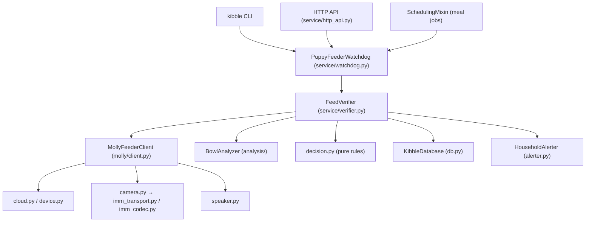

# Architecture

## Design rules
- **Small modules, one responsibility.** Facades (`MollyFeederClient`, `BowlAnalyzer`, `PuppyFeederWatchdog`)
  are composed of focused mixins/collaborators living in their own files.
- **Pure logic is separated from I/O** (`service/decision.py`, `molly/imm_codec.py`, `analysis/learning.py`)
  so it can be unit-tested without a feeder.
- **Explicit dependencies**: `FeedVerifier` receives its collaborators in the constructor (easy to fake in tests).
- **Data objects** (`service/models.py`, `analysis/results.py`) are plain dataclasses — ready to serialize to JSON.
- Old import paths (`watchdog.molly_client`, `watchdog.analyzer`, `watchdog.main`) remain as thin re-export shims.

## Adding the future web interface
The pieces a logged-in web UI needs already exist behind clean seams:

| Web UI feature | Where it plugs in |
| :--- | :--- |
| Login / sessions | New `watchdog/web/` app (e.g. a small ASGI/WSGI app) in front of the existing token check |
| Status, history, hopper, schedule | Existing `WatchdogApiHandler` routes (`service/http_api.py`) or call the same `db` / `molly` methods |
| Take a picture | `MollyFeederClient.capture_snapshot()` (`molly/camera.py`) |
| Record a clip with audio | `MollyFeederClient.capture_av_clip()` |
| Talk / play a sound | `MollyFeederClient.speak_tts()` / `play_audio_file()` (`molly/speaker.py`) |
| Live video + audio | `_ImmSessionProtocol` (`molly/imm_transport.py`) already decodes frames (`latest_rgb`) and mic audio; a streaming endpoint (MJPEG / WebSocket) can read those during a session |
| Review / labeling | `watchdog/review/` + `web/templates/review.html` |

Next refactor candidate: `CameraMixin._imm_session_async` (~380 lines) could be split into
signaling / connection / recording steps once a live-stream feature needs to reuse the connection part.
